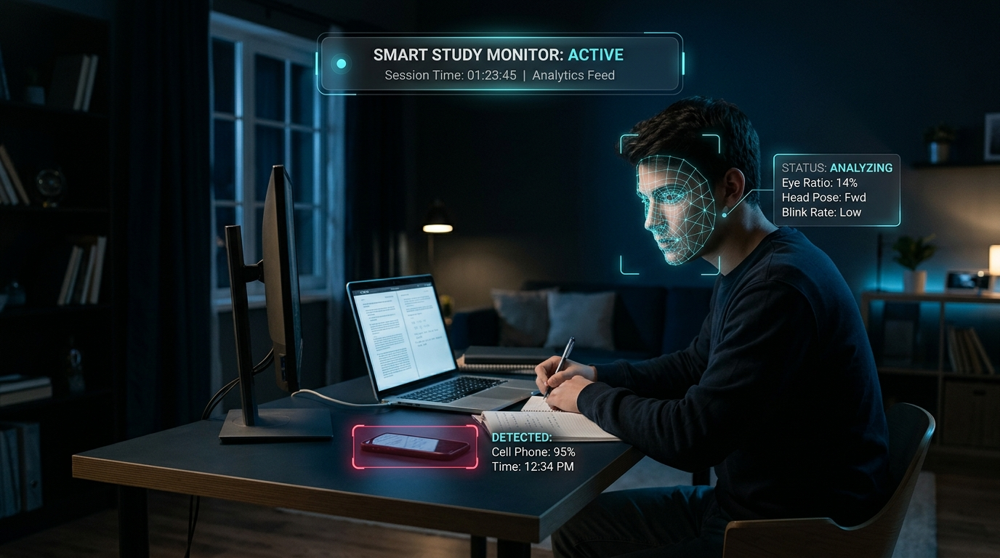

# 🎓 Smart Study Monitor

[](https://www.python.org/)
[](https://developers.google.com/mediapipe)
[](https://github.com/ultralytics/ultralytics)
[](https://opencv.org/)
[](https://pyga.me/)
[](https://opensource.org/licenses/MIT)

An intelligent, real-time AI computer vision assistant designed to enhance productivity and maintain study discipline. The **Smart Study Monitor** uses your webcam to detect drowsiness, phone distractions, and desk absence or face occlusion, triggering instant audio and visual alerts to keep you focused.

<p align="center">
  
</p>

---

## 🚀 Key Features

- **😴 Drowsiness & Sleep Detection**  
  Uses **MediaPipe Face Mesh** to track eye landmarks and computes the **Eye Aspect Ratio (EAR)** in real time. If your eyes stay closed beyond a configurable threshold (~15 frames), a loud waking alarm is triggered with an on-screen warning banner.

- **📱 Distraction & Phone Detection**  
  Utilizes the lightweight **YOLOv8n (Nano)** object detection model to identify cell phone presence in your frame with high accuracy (>50% confidence), prompting you to put your phone away.

- **🙈 Absence & Face Cover Warning**  
  Monitors whether your face is visible. If your face is covered or you step away from the desk for more than ~0.6 seconds, it sounds a reminder to stay attentive.

- **🔊 Non-Overlapping Smart Audio System**  
  Powered by `pygame-ce` mixer with priority queues, ensuring alarms play smoothly without overlapping noise or stutter.

- **⚡ Apple Silicon & Cross-Platform Support**  
  Optimized to run smoothly on macOS (Apple Silicon M-series & Intel), Windows, and Linux with full Python 3.10–3.14 compatibility.

---

## 🛠️ Tech Stack

| Component | Library / Framework | Description |
| :--- | :--- | :--- |
| **Vision & GUI** | `OpenCV (cv2)` | Video capture and window rendering |
| **Face Tracking** | `cvzone` + `MediaPipe` | 468-point facial landmark mesh & distance calculation |
| **Object Detection**| `Ultralytics YOLOv8` | Real-time cell phone detection model (`yolov8n.pt`) |
| **Audio Alert** | `pygame-ce` | Low-latency audio playback & channel state management |

---

## 📂 Project Structure

```text
Smart_study_monitor/
├── .gitignore               # Ignored files (virtualenv, caches, OS metadata)
├── .gitattributes          # Git LFS configuration for ML weights
├── app.py                   # Main application script
├── requirements.txt         # Project dependencies
├── yolov8n.pt               # Pre-trained YOLOv8 Nano weights
├── face_landmarker.task     # MediaPipe Face Landmarker model
├── hand_landmarker.task     # MediaPipe Hand Landmarker model
├── alarm.mp3                # Sleep alarm audio
├── faudio.mp3               # Face hidden / absence audio
├── paudio.mp3               # Phone distraction audio
├── README.md                # Project documentation
├── demo_preview.png         # Showcase demo preview banner
```

---

## ⚙️ Installation & Setup

### 1. Clone the Repository
```bash
git clone https://github.com/pabitralenka07/Smart_study_monitor.git
cd Smart_study_monitor
```

### 2. Set Up a Virtual Environment
```bash
# macOS / Linux
python3 -m venv .venv
source .venv/bin/activate

# Windows (Command Prompt)
python -m venv .venv
.venv\Scripts\activate
```

### 3. Install Dependencies
```bash
pip install --upgrade pip
pip install -r requirements.txt
```

> **Note for macOS Users:** Ensure your terminal (or VS Code) has camera permissions enabled:  
> *System Settings ➔ Privacy & Security ➔ Camera ➔ Enable your Terminal / IDE.*

---

## 🎬 How to Run

Activate your environment and run:
```bash
python app.py
```

### Controls:
- **`q`**: Press `q` while focused on the monitor window to safely exit the application and release camera resources.

---

## 🎛️ Configuration & Customization

You can fine-tune detection thresholds directly in `app.py`:

```python
# Landmark indices and ratio thresholds
SLEEP_THRESHOLD_FRAMES = 15      # Frames eyes must be closed before alarm triggers
COVER_THRESHOLD_FRAMES = 20      # Frames face must be missing before alert
EYE_RATIO_THRESHOLD    = 11.0    # Ratio below which eyes are considered closed

# Confidence threshold for phone detection
if classNames[cls_id] == "cell phone" and conf > 0.5:
    ...
```

You can also replace `alarm.mp3`, `faudio.mp3`, and `paudio.mp3` with your own custom audio cues.

---

## 🤝 Contributing

Contributions, issues, and feature requests are welcome!  
Feel free to open an issue or submit a pull request.

1. Fork the Project
2. Create your Feature Branch (`git checkout -b feature/AmazingFeature`)
3. Commit your Changes (`git commit -m 'Add some AmazingFeature'`)
4. Push to the Branch (`git push origin feature/AmazingFeature`)
5. Open a Pull Request

---

## 📄 License

This project is licensed under the MIT License — see the [LICENSE](LICENSE) file for details.

---

## 👤 Author

**Pabitra Lenka**  
- GitHub: [@pabitralenka07](https://github.com/pabitralenka07)

# Smart_study_monitor
